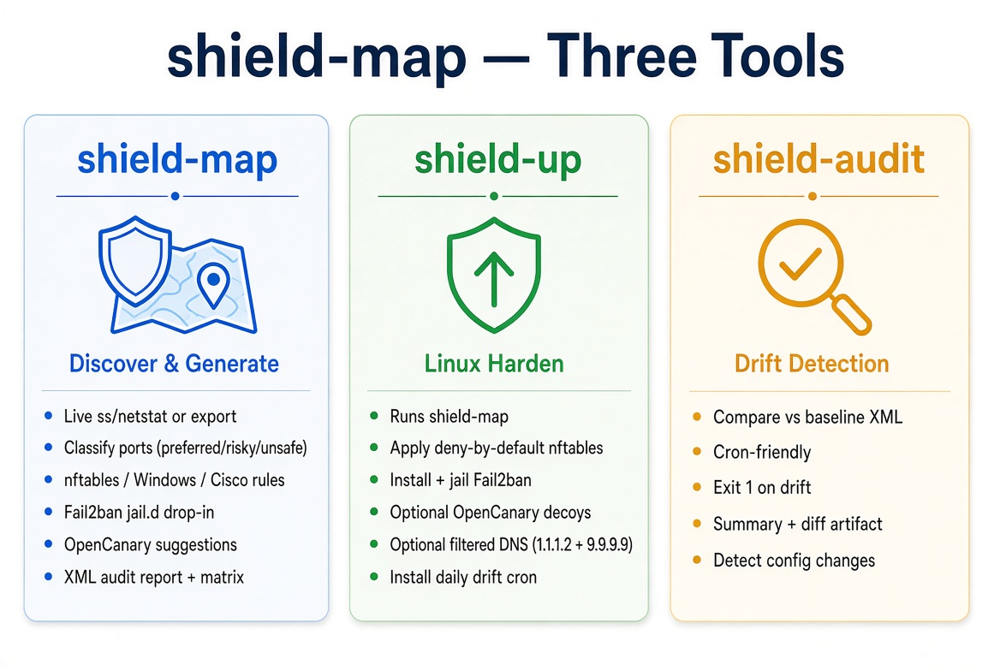
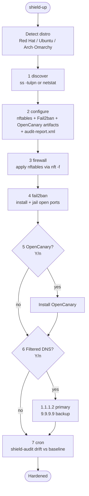
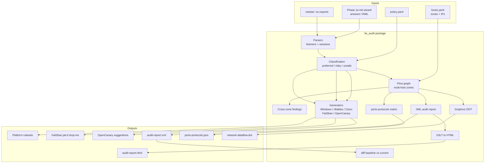

# shield-map



Home-lab tooling that turns **open ports** (live `ss`/`netstat` or exports) into **deny-by-default** firewall rules, Fail2ban jails, OpenCanary suggestions, filtered DNS options, and XML audit evidence (CIS Controls v8.1 IG1 / NIST SC-7 concepts).

**User-facing entry points** (recommended):

| Script | Role |
|--------|------|
| **`./shield-map`** | Capture / ingest → rulesets + Fail2ban + OpenCanary + XML report |
| **`./shield-up`** | Linux harden composition (apply firewall, Fail2ban, optional OpenCanary/DNS, drift cron) |
| **`./shield-audit`** | Drift check vs baseline (cron-friendly; exit 1 on drift) |

Python package import remains `fw_audit` for library consumers. Legacy `fw-audit` CLI still works with a deprecation note. See [docs/MIGRATION.md](docs/MIGRATION.md).

## Quick install

```bash
python3 -m venv .venv
.venv/bin/pip install -e ".[dev]"

./shield-map --help
./shield-up --help
./shield-audit --help
```

Pip also installs console scripts: `shield-map`, `shield-up`, `shield-audit` (and deprecated `fw-audit`).

## Architecture

### Linux harden path (`shield-up`)





## Recommended composition

| Layer | Role |
|-------|------|
| **Host firewall** | Deny-by-default nftables / Windows rules from **`shield-map`** |
| **Fail2ban** | Jails on intentionally open ports (`jail.d/shield-map.conf`) |
| **OpenCanary** | Decoys on unused high-value ports (optional via **`shield-up`**) |
| **Filtered DNS** | `1.1.1.2` primary + `9.9.9.9` backup (optional **`shield-up`** stage) |
| **Drift** | **`shield-audit`** cron vs baseline XML |

**SnarkSentinel** consumes XML / matrix / rules via the [library API](docs/INTEGRATION.md) (`import fw_audit`).

## Workflows

### A — `shield-map` (rules + report)

```bash
# Live capture on this host
./shield-map -o out/

# From an export
./shield-map --input ss.txt -o out/
./shield-map --input imports/ --hosts hosts.yaml --platform all -o out/
```

### B — `shield-up` (Linux harden)

| Stage | What it does | Prompt / flags |
|-------|----------------|----------------|
| **1 discover** | Capture listening ports | `--input` skips live capture |
| **2 configure** | nftables + Fail2ban + OpenCanary + `audit-report.xml` | Always |
| **3 firewall** | Apply nftables | Confirmed when `--apply` |
| **4 fail2ban** | Install packages + jail open ports | Confirmed when `--apply` |
| **5 opencanary** | Install with defaults | **Y/n** · `--opencanary` / `--no-opencanary` |
| **6 dns** | Filtered resolvers | **Y/n** · `--dns` / `--no-dns` |
| **7 cron** | Daily **`shield-audit`** drift | Confirmed when `--apply` |

```bash
./shield-up -o out-harden/                                    # scripts only
sudo ./shield-up --apply -o out-harden/                       # prompts
sudo ./shield-up --apply -y --opencanary --dns -o out-harden/ # non-interactive
```

### C — `shield-audit` (drift)

```bash
./shield-audit -b out-harden/audit-report.xml -o /tmp/drift
# exit 1 = drift; summary at /tmp/drift/drift-summary.txt
```

### D — Init wizard (no netstat yet)

```bash
fw-audit init -o out-init/                    # legacy CLI still available
fw-audit init --answers my-answers.yaml -o out-init/
```

Example: [docs/examples/client-simple-output.md](docs/examples/client-simple-output.md)

### E — Multi-host audit directory

```bash
./shield-map --input imports/ \
  --hosts examples/dmz-lab/hosts.yaml \
  -o out/ --platform all
```

Example: [docs/examples/dmz-lab-output.md](docs/examples/dmz-lab-output.md)

## Commands (canonical + legacy)

| Command | Description |
|---------|-------------|
| `shield-map` | Discover / ingest → rules + Fail2ban + OpenCanary + XML |
| `shield-up` | Linux harden stages (scripts-only by default) |
| `shield-audit` | Drift vs baseline (exit 1 on drift) |
| `fw-audit init` | Phase 1a questionnaire baseline (legacy CLI) |
| `fw-audit …` | Full Typer surface still available (deprecated name) |

## Fail2ban composition

Preferred/risky listeners emit:

```text
out/<hostname>/jail.d/shield-map.conf
```

Copy to `/etc/fail2ban/jail.d/` after review (or let `shield-up --apply` do it).

## Development and testing

```bash
python3 -m venv .venv
source .venv/bin/activate
pip install -e ".[dev]"
pytest -q
```

| Feature | Happy paths |
|---------|-------------|
| [`harden.feature`](features/harden.feature) | `shield-up` stages + distro scripts |
| [`all-in-one.feature`](features/all-in-one.feature) | `shield-map` / report / generate |
| [`diff.feature`](features/diff.feature) | `shield-audit` / diff drift |
| [`init.feature`](features/init.feature) | init baseline |
| [`library-api.feature`](features/library-api.feature) | `fw_audit` library contract |

## Status by phase

| Phase | Features |
|-------|----------|
| **1–2b** | Parsers, classification, XML/XSLT, multi-host, Fail2ban, OpenCanary |
| **2c** | `shield-up` stages + Red Hat / Ubuntu / Arch (Omarchy) scripts |
| **2d** | Top-level `shield-map` / `shield-up` / `shield-audit` entry points |
| **3** | Cloud generators (planned) |
| **4** | nmap XML, policy lint (planned) |

## Library API (SnarkSentinel)

```python
from fw_audit import analyze, diff, generate_local_only
```

Package name is unchanged this release — see [docs/INTEGRATION.md](docs/INTEGRATION.md) and [docs/MIGRATION.md](docs/MIGRATION.md).

## Documentation

- [docs/MIGRATION.md](docs/MIGRATION.md) — rename, shield-up/shield-audit ops, troubleshooting
- [openspec/spec.md](openspec/spec.md) — current capabilities
- [docs/INTEGRATION.md](docs/INTEGRATION.md) — library API
- [docs/PLAN.md](docs/PLAN.md) — roadmap
- [docs/GAP-ANALYSIS.md](docs/GAP-ANALYSIS.md)
- [docs/schema/network-audit.xsd](docs/schema/network-audit.xsd)

## License

Apache License 2.0 — see [LICENSE](LICENSE).
